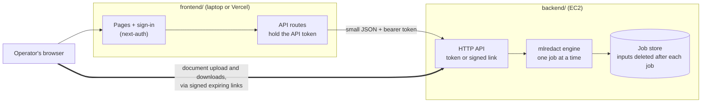

# mlredact

PII redaction for Australian medico-legal PDFs and scans. A document goes in, and a rebuilt,
de-identified PDF comes out, released only if every verification check passes.

The repository has two halves that are built, tested and hosted separately:

| Folder | What | Runs on | Docs |
|---|---|---|---|
| [backend/](backend/) | The redaction engine (Python), its CLI, and the HTTP API the frontend calls | EC2 (or any Linux host) | [backend/README.md](backend/README.md) |
| [frontend/](frontend/) | The web interface (Next.js): sign-in, upload, job tracking, the result viewer | Your laptop or Vercel | [frontend/README.md](frontend/README.md) |



Documents travel only between the browser and the backend. They never pass through the frontend's
host, which matters on Vercel: its functions cap requests and responses at 4.5 MB.

> **Known issue:** jobs are not yet separated per user. Every signed-in user sees every job, so
> configure a single user for now. See [KNOWN_ISSUES.md](KNOWN_ISSUES.md).

## Quick start (both on one machine)

```bash
# Backend: http://127.0.0.1:8100
cd backend
uv sync && uv run mlredact models fetch --profile broad
export MLREDACT_API_TOKEN=<32+ random characters>
export MLREDACT_API_CORS_ORIGINS=http://127.0.0.1:3100,http://localhost:3100
export MLREDACT_API_ALLOW_DEV_KEY=1          # synthetic documents only
uv run mlredact serve

# Frontend: http://127.0.0.1:3100
cd frontend
npm ci
cp .env.example .env.local                    # same MLREDACT_API_TOKEN, plus NEXTAUTH_SECRET and a user
npm run hash-password                         # hash for MLREDACT_UI_USERS
npm run dev
```

## Tests

```bash
make test             # backend fast suite (engine and API, no models) + frontend type-check and Vitest
```

Or each half on its own: `make -C backend test`, or `npm test` in `frontend/`.
