# mlredact architecture

This document describes the system **as built** at the current commit (plan phases P0–P4).
[PLAN.md](PLAN.md) is the design target. Where the code and the plan differ, this document follows
the code and says so. Individual decisions and their measurements are in [docs/adr/](docs/adr/).
Usage is in [README.md](README.md), and model hosting is in [MODELS.md](MODELS.md).

mlredact turns Australian medico-legal PDFs and scans into de-identified PDFs. It runs locally and
deterministically. It never edits the input. Every page is rasterised, and PII is found in the OCR
text and in ink that OCR could not explain. The raster is then edited and a brand-new PDF is built.
An independent verifier decides whether the result is released or quarantined.

## 1. Design principles

The rest of the design serves these invariants. A change that weakens one of them needs an ADR.

- **Rebuild, never edit.** No object, stream, font or metadata from the input reaches the output.
  Each output page is one image plus an optional invisible text layer. That layer is generated only
  from post-redaction content.
- **Recall before precision.** Detector outputs are unioned. One weak hit of a high-risk type is
  enough to redact. Unreadable marks in risky places are removed. Over-redaction is the accepted
  failure mode.
- **Geometry is canonical.** Every decision resolves to pixel boxes on one canonical raster
  (300 dpi by default). Models propose text spans. Geometry comes only from OCR tokens and region
  detectors.
- **Deterministic per runtime profile.** The same input, config, models, key and runtime profile
  give a byte-identical PDF and manifest.
- **Fail closed.** Any error, timeout or failed check leads to quarantine with content-free reason
  codes. There is no partial release and no human-review path.
- **Content never leaves the process except in the released artefacts.** Logs have no free text.
  Third-party exception messages are never kept. No temporary files are written.

## 2. System context

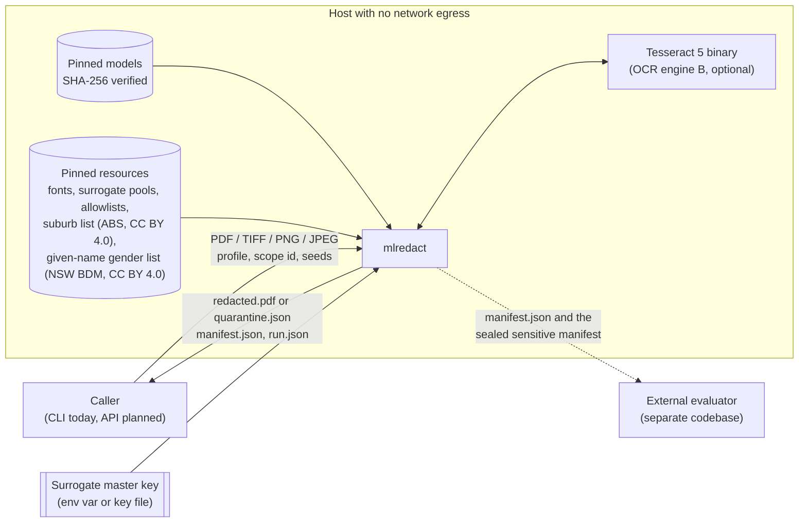

- Models are downloaded only at image-build or development time. During processing they are
  resolved and hash-checked, never downloaded.
- Evaluation is out of scope. This repository only provides a stable output contract (the manifest
  JSON Schema) for the evaluator.

## 3. Process topology

A job runs in one long-lived parent process plus a pool of spawned worker processes.

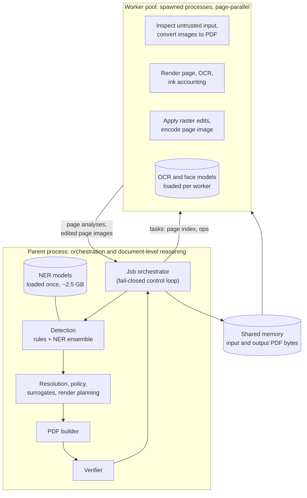

Why the work is split this way:

- **Only workers touch untrusted bytes** (PDF parsing, image decoding). A crash or timeout kills the
  pool and quarantines the job. The next job gets a fresh pool.
- **Page work is pure.** Each task depends only on the bytes, the page index, the config and the
  models. Pages therefore run in parallel without affecting the output, and results are merged by
  page index.
- **Detection runs in the parent, single-threaded.** It needs the whole document for propagation
  and clustering. The NER models are too heavy to load per worker. Workers sit idle meanwhile.
- **Pages are re-rendered from the source bytes in every pass** (analysis, redaction) instead of
  shipping rasters between processes. This relies on PDFium rendering deterministically.
- **Bytes travel through anonymous shared memory,** and Tesseract receives pages on stdin. Nothing
  derived from the document is written to disk during a job.

## 4. End-to-end job workflow

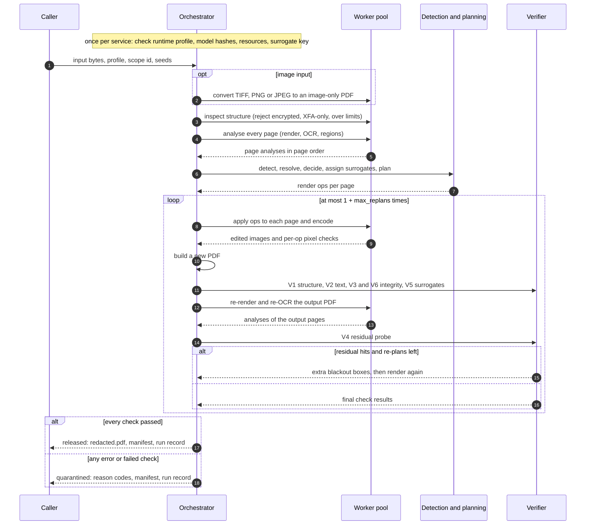

- The manifest is produced on every outcome, including quarantine, so failures can be analysed
  without seeing content.
- The sensitive manifest (the original text) is produced only when the caller supplies an evaluator
  public key, and only in sealed form.

## 5. Page analysis (per page, in workers)

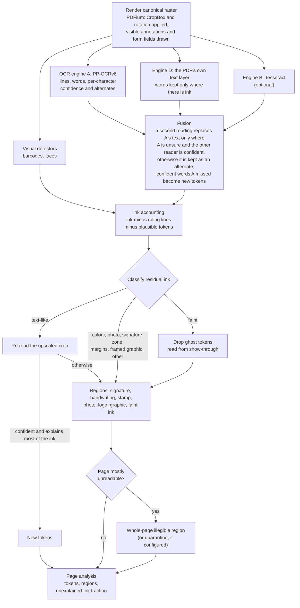

- **No page-level deskew or orientation step.** Engine A handles rotated and skewed lines itself.
  Mentions on lines more than 25° from horizontal are blacked out rather than typeset
  ([ADR 0005](docs/adr/0005-second-readers-and-orientation.md)).
- **Sideways and upside-down pages are held for review, not processed.** A page is never turned upright. When most of a
  page's text (at least half of its characters, and at least 30) runs more than 45° from horizontal as displayed, or
  lies on lines engine A read upside down, the document is quarantined after its output is built (section 8). The
  sideways direction comes from the lines read: a line runs along the long side of its box, as engine A reads it (a
  detected box at least 1.5 times taller than wide is read as vertical text), for OCR's boxes and the text layer's
  alike. Upside down comes from engine A's line classifier, which turns a line half a turn before reading it; the line
  keeps that mark (`Line.upside_down`). The page's `/Rotate` (recorded by intake) only names the cause
  ([layout/orientation.py](src/mlredact/layout/orientation.py)).
- **A token explains ink only if it is plausible** (confidence and size). A garbage read of a
  signature therefore cannot hide the signature
  ([ADR 0004](docs/adr/0004-regions-and-ink-accounting.md)).
- **Batch size is 1 everywhere.** A line's reading then never depends on the other lines on the page
  ([ADR 0001](docs/adr/0001-ocr-model-tiers.md)).
- **The verification pass is different.** It uses a smaller OCR configuration for diversity, and it
  runs only the visual detectors, not ink accounting.

## 6. Detection and resolution (whole document, in the parent)

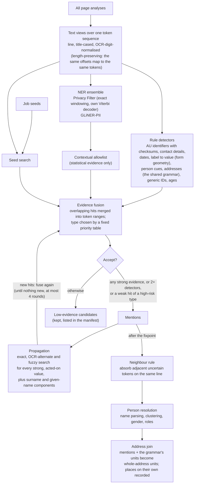

- **Evidence is strong or weak.** Labels, valid checksums, seeds and propagation give strong
  evidence. NER evidence is strong only above its threshold.
- **The allowlist can only veto statistical evidence.** It covers eponyms, drug names, public
  bodies and capital cities. It never vetoes rule, label, seed or propagation evidence. Propagation
  copies any accepted false positive across the document, so NER false positives are filtered
  early. Rule hits are too valuable to drop
  ([ADR 0002](docs/adr/0002-ner-ensemble.md)).
- **Propagation is constrained.** It spreads only strong mentions of types the profile acts on. It
  matches only minimal windows within one line, so it cannot absorb neighbouring label words.
- **Person resolution never decides whether a mention is redacted under Broad.** It decides
  surrogate consistency and, under claimant-focused, professional roles.
- **One grammar reads addresses for every stage** (`text/address/`, pure, no models). It reads a place from its end
  (country, postcode, state, suburb), the street line before it (building and property names, designators, house
  number, street name and type, corner forms, box kinds, DX), and the lines around it by geometry (a block, a page
  break, a form's boxes with compound or colon-less labels). A place anchors only when its postcode lies in the state's
  Australia Post ranges and its suburb is a locality of the state in the suburb list
  (`text/gazetteer.py`, `resources/gazetteer/`, ABS data, CC BY 4.0). The rule detectors (`detect/rules/address.py`,
  `labels.py`) turn what the grammar reads into candidates; the policy, the fakes, verification and the benchmark's
  reporting read the same units.
- **The join turns addresses into units** (`policy/addresses.py`, `addresses: whole`). Each unit is one STREET_ADDRESS
  mention (a form's boxes are one mention each, one unit): it absorbs the LOCALITY and POSTCODE mentions inside it and
  the state and country words nobody owns, never a person, organisation, contact or identifier word (their own rule
  replaces those). It finds repeats of a found address (a footer) and records the places that are on their own
  (prose, after a birth, injury, accident, incident or declaration phrase), which stay as the profile says. Its result
  carries the layouts for the fakes, the verification targets and the exempt positions. Under `addresses: parts` it
  returns the earlier per-part split instead.

## 7. From mentions to drawing operations

### Policy profiles

| Profile | How it differs from Broad |
|---|---|
| `broad` (default) | Replaces every person, identifier, contact detail, DOB/DoD, every address (whole) and linked organisation, and suburbs and postcodes on their own (capital cities on their own stay). Keeps clinical content and other dates |
| `claimant_focused` | Keeps professionals' names, provider/AHPRA/HPI numbers and organisations visible, under a one-sided rule ([ADR 0003](docs/adr/0003-profile-transformations.md)) |
| `maximal` | Shifts all dates by one keyed offset, top-codes ages of 90 and over to "90+", and re-typesets every line that contains a replacement |

Every profile removes non-text regions. Faint ink (show-through) is suppressed to paper colour
instead of being boxed.

`client` is not in this table because its action table is the client's own (`client.yaml`): addresses are replaced
whole like the other profiles, but places on their own, ages and every date are kept.

Every profile sets `addresses: whole`: units, roles, structure words, look-alikes and same-fake groups hold in all of
them, while each profile keeps its own action for a place on its own (`locality`, `postcode`). `address_state: keep`
(default) writes the original state word; `replace` moves all addresses of one state to one other state
([ADR 0006](docs/adr/0006-whole-addresses.md)).

### How a mention's action is settled

The planner degrades towards safer outputs. It never degrades to *keep*.

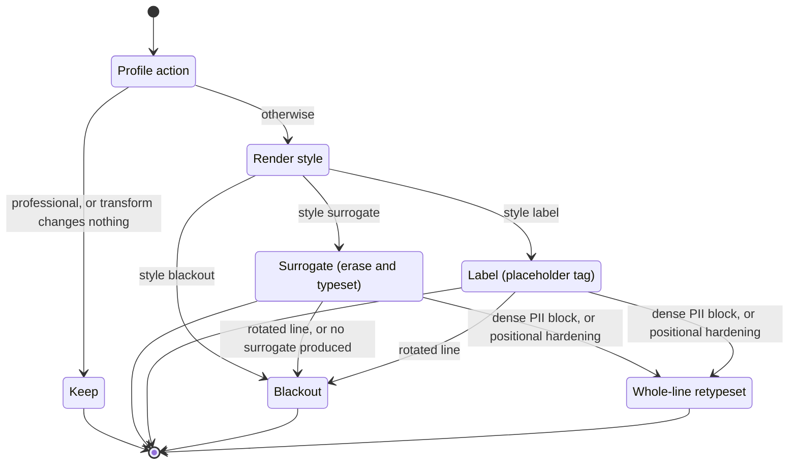

Date shifts and age top-coding are produced as surrogate text, so they follow the same path. A
transformation the code cannot perform (for example generalising a non-age) produces no surrogate
and so becomes a blackout.

### Surrogate derivation

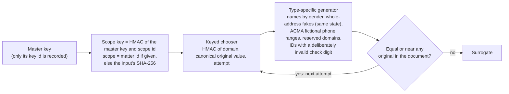

- **No mapping table is stored.** The same value in the same scope always maps to the same
  surrogate, so all documents of one matter stay consistent. A given name's fake also depends on the gender found
  for it in that document (a title, the NSW given-name list, else a family word right next to the name; unknown
  draws from both gendered pools). So when only some documents of a matter state a person's gender, that person can
  get two first-name fakes; keeping one would need a per-matter record, which is not stored (README, Known limits).
- **Names map per component** (surname, given name). "John Smith", "Mr Smith", "J. Smith" and
  "SMITH, John" therefore stay consistent, and family members share a surrogate surname.
- **Exhausted attempts raise an error,** which the orchestrator turns into quarantine. Address parts never run out:
  an empty choice widens (class, then state) instead of raising.
- **An address has one fake, chosen from its canonical key** (house number, street name, canonical type, unit and
  level; or box kind and number; or the suburb and state), under the scope key and not from the rest of the document.
  `St` and `Street`, case, commas, line breaks and OCR forms give one fake, a street line seen without its place gets
  the same street line, and one address gets the same fake in every document of a matter. Two different addresses in
  one suburb get independent fake suburbs. The suburb comes from the suburb list's fake pool (real localities with
  their own postcodes, ABS data) in the same state and class; a postcode keeps its digit count, differs from the
  original at every digit after those the state fixes, and lies in the state's ranges.

### Rendering and PDF construction

- **Planning.** Ops cover whole tokens, unioned per line, padded, and sorted in one canonical order.
- **Drawing a surrogate.** The box is erased to the local paper colour. The font size is calibrated
  from the original glyphs and the text sits on the original baseline. It is condensed or shrunk to
  fit and never drawn outside the erased box. Later ops never erase glyphs already drawn.
- **Per-op checks.** Every op is pixel-checked right after it is drawn. That result becomes the V3
  signal.
- **PDF construction.** The output PDF holds one image per page and an optional invisible text
  layer (base-14 font) generated from kept tokens and surrogates only. Metadata is fixed, the `/ID`
  is deterministic, and the file has a single revision.

## 8. Verification and release

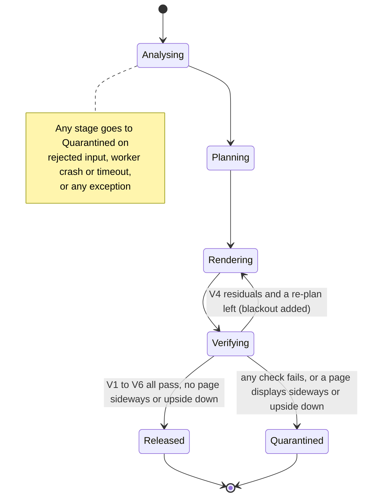

| Check | What the code verifies | Independent of the renderer? |
|---|---|---|
| V1 Structure | The output contains only allowlisted keys and objects, has one revision and the right page and image counts, and also opens in PDFium | Yes: parses the output bytes |
| V2 Text leak | No removed value (normalised, and digits-only for IDs) appears in extracted text, in string operands of any stream, or in info values. An address unit is searched by its verification targets (its text, its lines, the street line, number and street name, suburb with state and postcode, `label value` of form parts, and the suburb, street-name and building words as whole tokens); every occurrence must lie on an exempt position (this run's drawn fakes, places recorded as on their own, tokens of kept mentions) | Yes |
| V3 Pixels | Fills are uniform. Surrogate boxes contain nothing but the drawn glyphs. Suppressed areas hold only paper or strong ink | **No**: computed by the raster editor while drawing |
| V4 Residual | On the re-rendered, re-OCR'd output, outside the erased boxes: no removed value (exact, alternate or fuzzy match; for an address, its verification targets), no new strong hit from the rule detectors (NER is not re-run), no address unit or anchored place whose words are not this run's fakes (the join runs again on the output), no barcode or face. A residual that repeats a found address is re-planned with that address's fake | Yes: shares only normalisers, rule detectors and the grammar |
| V5 Surrogates | No surrogate equals or nearly equals an original. IDs fail their checksums, phones are in ACMA ranges, domains are reserved. Every date moves by one common offset, and no age of 90 or over remains. Every word and number of an address fake differs from every identifying word and number of every address of the document, the postcode lies in the state's ranges and differs from the original at every digit after the state's own, and no two different addresses share a whole fake | Re-checked separately from the generators |
| V6 Integrity | Page count and page sizes match. The number of planned ops equals the number applied | Partly: the applied count is reported by the worker |

**Limit:** verification shows that planned removals happened. It cannot find PII that every
detector missed. Recall is measured by the external evaluator, not here.

**Sideways and upside-down pages are held for review.** The pipeline reads and draws every page as displayed, left to
right, so a page turned on its side or upside down comes out wrecked (broken text, misplaced fakes, black bars, fakes
typeset upright over upside-down lines), yet passes V1 to V6. After the checks, the job is therefore quarantined,
whatever they found, when a page displays sideways: reason `E_PAGE_ROTATED_SIDEWAYS` when the page's `/Rotate` (90 or
270) turns it on its side, `E_PAGE_CONTENT_SIDEWAYS` when the page is upright but its text was drawn or scanned on its
side; or upside down: `E_PAGE_ROTATED_UPSIDE_DOWN` when its `/Rotate` (180) turns it, `E_PAGE_CONTENT_UPSIDE_DOWN`
when its text was drawn or scanned upside down. A warning `job.page_sideways` or `job.page_upside_down` names the page.
The output is still built: `--keep-held-back` returns it, and `mlredact bench` hands it over as `output.pdf`. A page
whose `/Rotate` turns turned content upright, and a page with only a little turned text, are processed as before.

## 9. Data model and identity

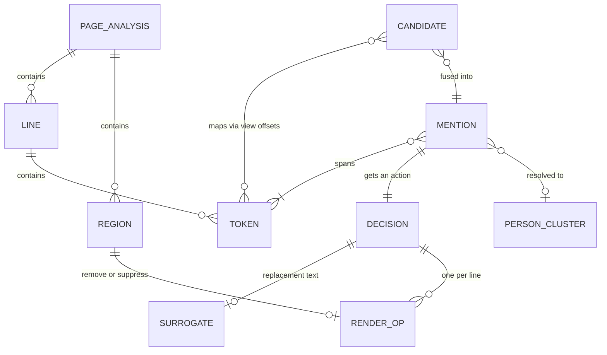

- **The token is the unit everything converts through.** Detectors report character offsets in a
  view, and fusion converts them to token ranges. Planning converts tokens to pixel boxes. Views are
  length-preserving, so no realignment is ever needed.
- **The removal set is used four times.** The values of removed mentions are forbidden as
  surrogates, are V2's search needles, are V4's probe targets, and form the log scrub list. For an address the
  values are the unit's verification targets, not its parts.
- **An address unit is identified by position.** Its id is a content id of its first and last token, a unit
  mention's id of the unit and the mention's tokens, so reruns agree. The job trace (in memory, for the benchmark
  adapter) carries the layouts, the units, the places kept on their own and the fakes drawn; the manifest and the run
  record hold no original address text (the manifest lists the fakes, which are visible in the PDF).
- **Identifiers come from positions** (page, line, word, input hash), never from values or
  randomness. Manifests from reruns therefore diff cleanly and reveal nothing.
- **Document text is hidden from `repr`.** Standalone values such as seeds use a `Sensitive`
  wrapper that refuses to print or serialise.
- **Every emitted collection is sorted by a total key** (page, position, type, id).

## 10. Configuration, provenance and determinism

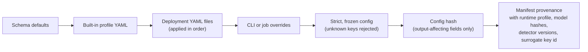

- **Runtime profile.** The profile is OS + architecture + x86 feature level (v2/v3/v4) + pinned
  native library versions. Production pins the expected profile, and startup fails on a mismatch.
  Windows development runs are not a determinism target.
- **Numeric controls.**
  - Thread counts are fixed in every process.
  - ONNX Runtime uses deterministic compute and sequential execution.
  - Batch size is 1.
  - NER windowing is exact: Privacy Filter windows carry their full receptive field of context.
- **What counts as config identity.**
  - Thread counts are part of the config hash, because Privacy Filter output depends on them.
  - Worker count, timeouts and the models directory are not.
- **No hidden variation.**
  - Document-level stages do not depend on Python's hash seed (tested).
  - IDs come from positions, and output is canonically ordered.
  - The manifest has no timestamps. Timings go to `run.json`.
- **Randomness.** The only randomness is the keyed HMAC chooser. The sealed sensitive manifest is
  deliberately non-deterministic: each one uses a fresh ephemeral key.

## 11. Security and privacy posture

In place:

- **Logging.** Logs are events with allowlisted, typed fields and no free-text messages.
  Third-party log records are reduced to a hash and a length. A per-job scrub list masks removed
  values as a last line of defence.
- **Errors.** Errors carry reason codes and scalar parameters only. Third-party exception messages
  and tracebacks are never logged or returned.
- **Names and files.** Input filenames are never echoed, and outputs have fixed names.
- **Data handling.** Content stays in memory. Outputs are written atomically, with owner-only
  permissions on POSIX.
- **Surrogate key.** The development surrogate key needs explicit opt-in and is refused when a
  production runtime profile is pinned.
- **Container.** The Compose sketch runs with no network, a read-only root filesystem, a non-root
  user, dropped capabilities, no core dumps and a RAM-backed `/tmp`.
- **Licences.** A CI licence gate blocks copyleft and non-commercial dependencies. The suburb list is ABS data under
  CC BY 4.0; its attribution is in [README.md](README.md) (Third-party data) and next to the list
  (`src/mlredact/resources/gazetteer/ATTRIBUTION.txt`). The given-name gender list is NSW Registry of Births, Deaths
  and Marriages data under CC BY 4.0; its attribution is in the same README section and next to the list
  (`src/mlredact/resources/names/ATTRIBUTION.txt`).

Planned but not built ([PLAN.md](PLAN.md) §14, §17):

- an OS-level sandbox for parsing (seccomp, rlimits);
- an encrypted per-job workspace with crypto-shredding;
- an API with authentication, RBAC and an audit log;
- signed images and models;
- an SBOM.

## 12. Output contract

| Artefact | When | Contents |
|---|---|---|
| `redacted.pdf` | released only | The rebuilt PDF |
| `manifest.json` | always | Types, actions, boxes (px and pt), evidence, regions, low-evidence candidates, verification results, provenance. Never original text. Surrogate strings are included because they are visible in the PDF |
| `run.json` | always | Job id, timings, worker count. Operational and non-deterministic |
| `quarantine.json` | quarantined only | Reason codes and the input hash |
| `sensitive-manifest.sealed.json` | only with an evaluator key | The original text, sealed with X25519, HKDF-SHA256 and ChaCha20-Poly1305 |

The manifest follows a strict JSON Schema ([schemas/manifest.v1.json](schemas/manifest.v1.json))
that rejects unknown fields. An additive change bumps the minor version. The CLI exits with 0 when
released, 2 when quarantined and 1 on usage or environment errors.

---

## Mental model

### Relevant architecture

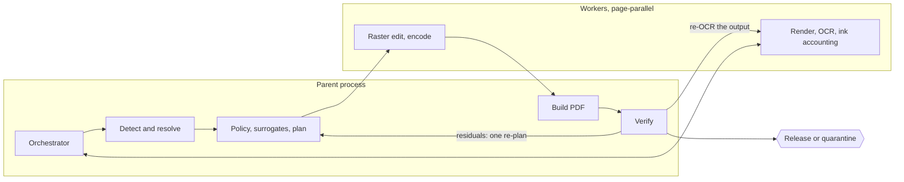

### Primary end-to-end workflow

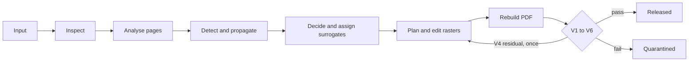

### Key components and responsibilities

- **Orchestrator.** Owns the job lifecycle, the re-plan loop and the release decision. Turns every
  failure into quarantine.
- **Worker pool.** The only place untrusted bytes are parsed. Runs pages in parallel and returns
  results in a fixed order. A crash or timeout gives a fresh pool.
- **Page analysis.** Produces the canonical raster, fused OCR tokens with alternates, and a region
  for every patch of ink OCR could not explain.
- **Detection.** Runs rules and NER on length-preserving views. Fuses evidence with a recall bias
  and propagates to a fixpoint.
- **Resolution.** Parses and clusters names so surrogates stay consistent. Identifies
  professionals for the claimant-focused profile.
- **Policy.** Maps each entity type to an action through the profile table. Transforms that would
  change nothing settle to keep.
- **Surrogates.** Derived statelessly from a key, and safe by construction.
- **Planner and renderer.** Turn whole-token boxes into erase-and-typeset or fill operations.
  Escalate dense blocks to whole-line retypesetting and fall back to blackout.
- **PDF builder.** Builds the PDF from scratch: image-only pages plus a post-redaction text layer.
- **Verifier.** The release gate. Parses the output on its own.
- **Manifest.** The content-free, deterministic contract with the evaluator.

### Important data/state relationships

- Candidate (per detector and view) → Mention (fused, accepted) → Decision (action) → Surrogate →
  RenderOp per line → the box actually erased. The manifest records both the planned and the
  erased box.
- Region → RenderOp directly, with no text path.
- The removal set feeds four consumers: surrogate collision checks, V2, V4 and the log scrubber.
- Job status is binary: released or quarantined. Both outcomes produce a manifest.

### Existing patterns worth preserving

- **Fail-safe degradation.** Anything unsupported or uncertain becomes blackout or remove, never
  keep.
- **Evidence asymmetry.** Allowlists veto only weak statistical evidence.
- **Verifier independence.** The verification package imports nothing from rendering. Keep it
  parsing output bytes.
- **Process discipline.**
  - Worker tasks are pure and indexed by page.
  - Heavy models load once per process.
- **Determinism hygiene.**
  - IDs come from positions.
  - Collections are sorted by a total key.
  - Anything hashed or emitted goes through canonical JSON.
- **Content-free errors and logs.** Text fields are hidden from `repr`.
- **Strict config.** Unknown keys are rejected and output-affecting fields are hashed.
- **Pinned, hash-verified models and resources.**
- **Decisions recorded as ADRs** together with their measurements.

### Relevant tests and coverage gaps

**Fast suite** (no models; runs on every pull request):

- detection: detectors and checksums, fusion, propagation, NER windowing, Viterbi and the
  allowlist (without weights);
- rendering: region classification, rendering and typesetting;
- surrogates: generation and V5, Maximal date shifting, name resolution and roles;
- foundations: config and canonical serialisation, worker-pool crash recovery, manifest schema
  against the code's enumerations;
- security: logging safety, the sealed manifest, verifier mutation tests for V1–V4;
- determinism: independence from the hash seed.

**Slow suite** (models; nightly):

- documents: synthetic letters end to end (scanned, digital, TIFF);
- determinism: byte-identical reruns, independence from the worker count, scope consistency;
- profiles: every profile and render style;
- safety: removal of visual artefacts, quarantine of encrypted and non-PDF input, a manifest
  without text;
- engines: the NER models on real weights, and Tesseract (skipped where it is absent).

**Gaps** (no test found):

- the V4 re-plan loop end to end (residual, then re-plan, then pass or fail);
- the worker timeout path (only a crash is tested);
- the CLI: exit codes, fixed filenames, the seeds file;
- pipeline-level paths: XFA-only rejection, page and size limits, illegible-page quarantine;
- a malformed or malicious PDF corpus, or fuzzing;
- page-order shuffling, and golden hashes per runtime profile;
- real documents. These stay out of the repository by design, so recall is not measured here.

### Constraints and risks

- **Recall ceiling.** OCR plus detectors bound recall, and verification cannot raise it.
- **Renderer-side checks.** The renderer reports V3 itself, and the worker reports the applied-op
  count for V6, so a renderer bug could pass both. V4's re-OCR is the backstop.
- **V4 is rules-only.** NER is not re-run on the output.
- **NER recall.** Off-the-shelf NER recall on clinical and legal text is low. Fine-tuning (plan P7)
  is the main lever, and it has not been done.
- **Throughput.** Detection is serial in the parent, and Privacy Filter cost grows with document
  length (about 11.5 s per 1,024 tokens on CPU). Long records are slow while the workers sit idle.
- **Memory.** NER needs about 2.5 GB plus about 0.4 GB per OCR worker. The development laptop runs
  with NER and Tesseract off: lower recall, never for real documents.
- **Determinism scope.**
  - Determinism holds only within one runtime profile.
  - Windows is not a determinism target.
  - Engine B has not yet been validated on Linux ([ADR 0005](docs/adr/0005-second-readers-and-orientation.md)).
- **Small curated resources.**
  - Surrogate name pools are small: about 160 surnames and 180 given names. Address fakes draw suburbs from the suburb
    list's fake pool (about 6,900 localities with their own postcodes), but street names come from a short list (about 60).
  - The interim drug allowlist has 48 entries.
  - Variety and allowlist coverage are therefore limited.
- **Heuristic regions.** Figures, body charts and unreadable print are removed, which costs
  utility.
- **Quarantine rate.** Failing closed makes the quarantine rate an operational risk, and there is
  no human-review path.
- **Sideways and upside-down pages.** A document with a page turned on its side or upside down is held for review,
  not processed: it needs the page turned upright, or redaction by hand.
- **Isolation.** There is no OS sandbox or encrypted workspace yet. Isolation rests on process
  boundaries and container settings.

### Facts vs assumptions

**Facts** (checked in the code at this commit):

- Untrusted parsing and decoding run only in workers. Detection and NER run in the parent.
- No document-derived data is written to disk during a job. There is no OS-level sandbox and no
  encrypted workspace.
- Any exception, including surrogate-pool exhaustion, ends in quarantine. The re-plan loop runs
  at most `max_replans` times (default 1).
- V3 is computed by the raster editor. V4 re-detection uses rule detectors only.
- The views built are line, title-cased and OCR-normalised. A *prose* view is listed in the types
  but not built. There is no page-level deskew or orientation stage.
- These planned items do not exist in the code yet:
  - VLM second reader, LLM sweep (P5);
  - API, queue, observability (P6);
  - name gazetteers (the suburb list exists);
  - a trained layout model;
  - nickname tables, née/aka linking.

**Assumptions and unverified claims:**

- A page re-rendered by PDFium is assumed bit-identical between the analysis and redaction passes.
  The design relies on this, but no test asserts it directly.
- The performance and memory figures come from ADR measurements on a development laptop. The
  production sizing in [PLAN.md](PLAN.md) §16 is an estimate.
- Reproducibility across machines within one runtime profile is assumed. No golden hashes exist
  yet to test it.
- The ink-accounting heuristics and thresholds were tuned on synthetic scans. Whether they
  generalise to real scans is untested.
- Where this document describes intent (principles, planned items), it reflects
  [PLAN.md](PLAN.md) and the ADRs rather than measured behaviour.
