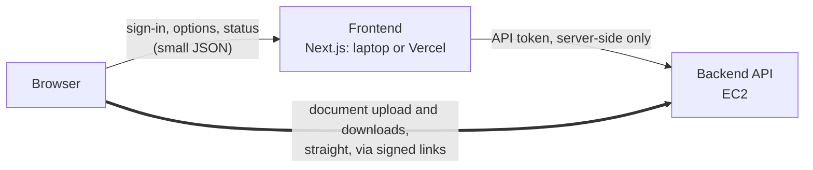

# mlredact frontend

The web interface for mlredact, built with Next.js (App Router). It submits documents, follows jobs and
shows each result: the redacted PDF with the manifest's boxes overlaid, the V1–V6 checks, per-page
statistics and provenance.

It holds no documents and runs no engine. All of that is the backend's job ([../backend](../backend)),
and the frontend talks to it over HTTP. That way they can be hosted apart: the frontend on your laptop
or Vercel, and the backend on EC2.



- **Documents never pass through the frontend's host.** Vercel caps a function's request and response
  at 4.5 MB, and a third party has no business seeing medico-legal files. The browser uploads straight
  to the backend with a one-time link that expires in minutes. Downloads, the PDF viewer and the
  manifest use fresh signed links the same way.
- **The API token stays on the frontend's server.** The browser only ever gets signed, expiring links,
  each tied to one job and one file.
- **Every page and API route needs a signed-in user** (next-auth). Mutations also need a custom
  header, so another site can't post with a user's cookie.

## Running it on your laptop

```bash
cd frontend
npm ci
cp .env.example .env.local      # fill it in: see "Settings"
npm run hash-password           # makes a hash for MLREDACT_UI_USERS
npm run dev                     # http://127.0.0.1:3100
```

The backend must be reachable at `MLREDACT_API_URL`. To use the one on EC2 without a domain, open an
SSH tunnel. The backend then appears at `http://127.0.0.1:8100` on your laptop, encrypted inside SSH,
with no new ports opened on EC2:

```bash
ssh -L 8100:127.0.0.1:8100 ubuntu@<ec2-address>
```

On the backend, set `MLREDACT_API_CORS_ORIGINS=http://127.0.0.1:3100,http://localhost:3100` so the
browser may upload to it directly.

## Deploying on Vercel

1. Import the repository and set **Root Directory** to `frontend`.
2. Add the settings below under Environment Variables. `NEXTAUTH_URL` is your Vercel address.
3. The backend must have an `https://` address, because a Vercel page may not call plain HTTP. Put that
   address in `MLREDACT_API_URL`, and the Vercel address in the backend's `MLREDACT_API_CORS_ORIGINS`.
   Until you have a domain, a Cloudflare quick tunnel on EC2 gives a temporary `https://` address
   (`cloudflared tunnel --url http://127.0.0.1:8100`). Documents then pass through Cloudflare, so use it
   for testing with synthetic documents only.
4. For Google sign-in, add `https://<vercel-address>/api/auth/callback/google` as a redirect URI on the
   OAuth client.

The self-check route asks Vercel for up to 300 s (`maxDuration`). Plans with a lower limit cut it short,
and the check then shows as failed even if the backend completes it.

## Settings

| Variable | Purpose |
|---|---|
| `MLREDACT_API_URL` | Backend base URL, as this app's server reaches it |
| `MLREDACT_API_PUBLIC_URL` | Backend base URL as browsers reach it, if different (defaults to the above) |
| `MLREDACT_API_TOKEN` | Shared secret, the same as the backend's. Server-side only |
| `NEXTAUTH_SECRET` | Random secret for session cookies |
| `NEXTAUTH_URL` | This app's own address |
| `MLREDACT_UI_USERS` | Email-and-password users: `email=hash,email=hash` (`npm run hash-password`) |
| `GOOGLE_CLIENT_ID`, `GOOGLE_CLIENT_SECRET` | Google sign-in (optional) |
| `MLREDACT_UI_GOOGLE_ALLOWED_EMAILS`, `…_DOMAINS` | Who may sign in with Google. With neither set, no Google account gets in |

Sessions last 8 hours. Passwords are hashed with scrypt; the hash format is hex and dots only, so it
survives `.env` files and dashboards.

## Tests

```bash
npm test              # Vitest, a few seconds, no backend needed
npm run typecheck
```

- **Contract:** the UI's enumerations and its fixture manifests are validated against
  [backend/schemas/manifest.v1.json](../backend/schemas/manifest.v1.json).
- **Vocabulary:** every code in the schema has a label.
- **Overlay model.**
- **Request rules:** mutation header and Origin.
- **Passwords, sign-in and the Google allowlist.**
- **API routes:** run against a fake backend. These check that a session is required, that the token
  is added server-side and never echoed, that job IDs are validated before they reach a backend URL,
  and that signed links become absolute URLs.

The fixture manifests in `test/fixtures/` come from the backend's stub engine:

```bash
python backend/tests/api/stub_engine.py run <input starting "%STUB released"> --out <dir> --style surrogate
```

## Layout

```
src/app/            pages (overview, new redaction, jobs, job detail, system, login) and API routes
src/app/api/        thin, session-checked forwards to the backend; auth/[...nextauth] for sign-in
src/proxy.ts        sends signed-out visitors to /login (every API route checks again itself)
src/lib/auth.ts     next-auth: email and password, Google with an allowlist
src/lib/server/     backend client, request rules, password hashing (server-only)
src/lib/            manifest types, job types, vocabulary for codes, overlay model, client fetch
src/components/     UI: form, jobs table, document viewer (pdf.js + overlay), tab panels, login
scripts/            pdf.js worker copy, telemetry-off Next.js launcher, password hashing
test/               Vitest suites, fixtures and support
```
