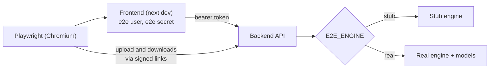

# End-to-end tests

Playwright drives the real frontend in Chromium against the real backend API. The only thing that
changes between the two modes is the engine behind the API:

| Mode | Command | Engine | A run takes |
|---|---|---|---|
| Stub (default) | `npm run test:e2e` | `backend/tests/api/stub_engine.py`: no models, each job's outcome is picked by the document's first line | ~1.5 min |
| Real | `npm run test:e2e:real` | the real `mlredact` engine with its models, on synthetic documents | several minutes per released job |



Playwright starts both servers on ports of their own (frontend 3199, backend 8199), so a dev server on
3100/8100 is left alone, and `.env.local` is overridden. Each run starts with an empty jobs directory.

## Setup, once

```bash
cd backend && uv sync                    # the backend's Python, used for the API and the stub
cd ../frontend && npm ci && npx playwright install chromium
```

Real mode also needs the models (`uv run mlredact models fetch --profile broad`, about 1.8 GB) and
Tesseract on the PATH, so `uv run mlredact selfcheck` passes.

## What is covered

| Spec | Flow |
|---|---|
| `auth.spec.ts` | sign-in redirect, API refuses no session, wrong password, return to the requested page, sign out |
| `redact.spec.ts` | released job (viewer draws the page, six checks passed, PDF download); quarantined job (reasons, no PDF); engine failure (reason code) |
| `job-actions.spec.ts` | stop a running job; delete a finished one |
| `jobs-list.spec.ts` | a finished job is listed with its result and opens from the list |
| `system.spec.ts` | server settings and the self-check |

What each scenario submits:

| Scenario | Stub mode | Real mode |
|---|---|---|
| Released | `%STUB released` | a synthetic IME letter (`backend/tools/synthdocs`) |
| Quarantined | `%STUB quarantined` (V4 fails) | the same letter, encrypted: rejected at intake (`E_INPUT_ENCRYPTED`) |
| Engine failure | `%STUB error` | a surrogate job with no key (`E_CONFIG_INVALID`). Skipped if the backend has `MLREDACT_SURROGATE_KEY` |
| Stop / delete | `%STUB hang` | the letter, stopped while it runs |

## Against a backend that is already running (e.g. EC2)

```bash
ssh -L 8100:127.0.0.1:8100 ubuntu@<ec2-address>     # in another terminal
E2E_ENGINE=real E2E_BACKEND_URL=http://127.0.0.1:8100 E2E_BACKEND_TOKEN=<its MLREDACT_API_TOKEN> npx playwright test
```

Playwright then starts only the frontend. The browser uploads straight to that backend, so its
`MLREDACT_API_CORS_ORIGINS` must include `http://127.0.0.1:3199` (or set `E2E_FRONTEND_PORT` to an
origin it already allows, with nothing else on that port). Synthetic documents only.

## Settings

| Variable | Default | Purpose |
|---|---|---|
| `E2E_ENGINE` | `stub` | `stub` or `real` |
| `E2E_BACKEND_URL`, `E2E_BACKEND_TOKEN` | – | use a running backend instead of starting one (real mode only) |
| `E2E_FRONTEND_PORT`, `E2E_BACKEND_PORT` | `3199`, `8199` | ports for the servers Playwright starts |
| `E2E_PYTHON` | `backend/.venv` | the backend's Python |

Extra arguments go to Playwright: `npm run test:e2e -- redact.spec.ts --headed`, `--ui`, `--debug`.
Traces, screenshots and the HTML report of failed tests land in `e2e/.generated/`
(`npx playwright show-report e2e/.generated/report`).
